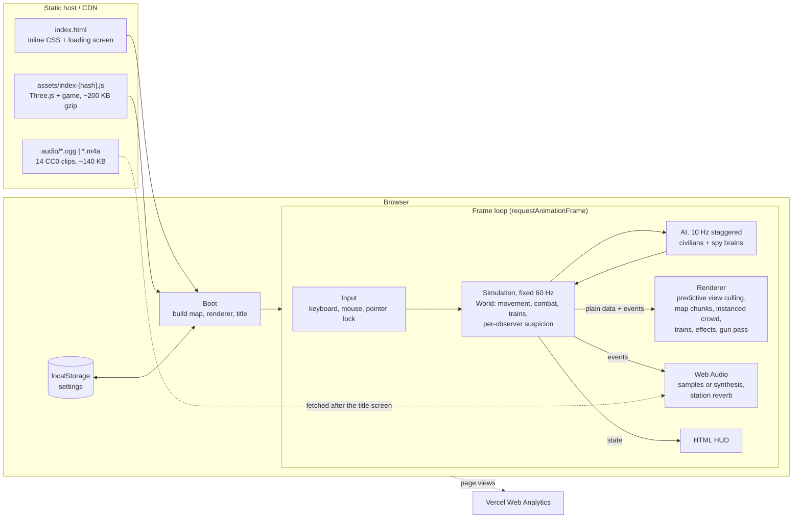

# Double Agent

A first-person spy shooter for the browser. Eight assassins in near-identical suits hide in a crowd of civilians inside a grand train station. Each one has a secret target and is hunted by someone they don't know. Acting human keeps you hidden. Acting like a killer gets you found.

Single player: you and 7 AI spies, plus 112 AI civilians, across a 156 m × 54 m station. It has a concourse with a gallery, a west waiting room and restaurant, shop corridors, and three 70 m platforms where trains arrive, dwell and depart. Geometry, textures and most sound are procedural. The shipped assets are 14 short CC0 gun, casing and impact recordings (about 140 KB, loaded after the title screen), three self-hosted OFL fonts (about 118 KB), and one 42 KB title still for low quality; see [docs/CREDITS.md](docs/CREDITS.md). Without the recordings the game falls back to synthesised sound.

The title screen shows the live station behind the logotype, a "What is Double Agent?" strip of four illustrated cards and a departure-board scoring table. The first time you press Play, a four-card briefing comes first, and that first match shows contextual tips (your dossier, sitting, suspicion, the scanner, the tracks, the trains). After that, Play starts a match straight away; How to Play is always in the menu. **Practice** (on the title screen) is the same station with nobody hunting you and a target who stands still; it ends at your first target kill.

## Run

```bash
npm install
npm run dev        # http://localhost:5173
npm run build      # type-check (strict) + production bundle in dist/
npm run preview    # serve the production build
npm test           # Vitest: unit tests + headless full-match simulation
```

Optional URL parameters: `?seed=123` replays a match with the same seed (the seed is printed to the console), and `?spies=10` sets the spy count (8–10).

## Controls

| Input | Action |
|---|---|
| WASD | Walk (2.2 m/s) |
| Shift | Run (5 m/s, suspicious) |
| C or Ctrl | Crouch |
| Space | Jump |
| Mouse | Look (click the game to capture the mouse) |
| Right mouse | Draw and aim (zooms in) |
| Left mouse | Fire |
| R | Reload |
| Q / E / F | Scanner / Disguise / Smoke |
| G | Interact: sit on a bench or café chair, read the paper, check the departures board, wait at a counter. Press again or move to stop. At a platform edge: drop to the tracks, or climb back up (Space also climbs). At an open train door: board or step off. |
| Tab | Scoreboard |
| Esc | Pause |
| F3 | Debug overlay (FPS, frame time, draw calls, measured ticks/s and walking speed) |

Ctrl+W is the browser's close-tab shortcut, so C is the safer crouch key. The game asks for confirmation before the page closes during a match.

## Rules

- **The target chain.** All spies form one cycle, and each targets the next spy in it. When you kill someone, you inherit their target. The chain always stays valid through deaths and respawns.
- **Scoring.**

  | Kill | Points |
  |---|---|
  | Your target | +100 |
  | Your target, unseen (no other spy saw you in the last 2 s) | +50 extra |
  | Your target, headshot | +25 extra |
  | Your hunter | +50 |
  | Any other spy | −25 |
  | A civilian | −50, and every spy sees a red marker over you for 5 s |

- **Health.** You have 100 health, and it does not regenerate. A headshot does 100 damage and a body shot does 55. You respawn after 5 s, far from other spies.
- **Suspicion is per person (0–100 each).** Every NPC, and you, keeps its own suspicion of each spy, built only from what it has seen itself. Nothing is shared: one witness's alarm tells nobody else anything. While someone can see you, these raise *their* suspicion of you:
  - running: +25/s (less inside a panicking crowd)
  - weapon drawn: +15/s
  - aiming: +30/s
  - being on the tracks: +20/s
  - staying within 1.2 m of another spy for more than 3 s: +10/s
  - jumping: +10, using the scanner: +20
  - firing: sets it to 100

  Out of their sight it decays at 20/s (faster while you blend in). So drawing your gun where nobody can see you costs nothing. The HUD meter shows your most suspicious witness and how many people can see you right now. A hunter whose *own* suspicion of you passes 60 sees you outlined in red. You see your target outlined only if *you* saw them act suspiciously. A civilian who grows that suspicious of someone nearby backs away on their own.
- **Blending in (G).** Sitting lets suspicion decay at 30/s, and a standing activity (newspaper, departures board, counter) at 26/s. Hunters also learn half as much from watching you while you do it. The bonus stops after 25 s in the same spot. You can draw and fire while seated, but you can't move; standing up takes 0.4 s. Drawing, firing or moving ends a standing activity. AI spies sit and read too, so sitting is not proof of innocence.
- **The tracks.** You can walk off a platform edge or press G to drop onto a track bed, and climb back up with Space or G at any point along the platform (a 0.7 s mantle; a plain jump is too low). It is a sunken route: crouch and people standing back on the platforms can't see you. It is also reckless. Being down there adds +20/s suspicion, nearby civilians panic, and an arriving or departing train sounds its horn and then kills anyone on its bed (no points for anyone; normal respawn). A stopped train is solid and safe to walk around. Civilians and AI spies never go down there.
- **Trains.** While a train stands at the platform with its doors open, walk straight in through a doorway (or press G at a door). Inside you can walk around, sit on the benches (seated blending works there too), and walk back out the same way. The car walls block sight and bullets, but the windows and open doorways don't: you can be seen and shot through them, and you can shoot out. Stay aboard when the doors close and you ride out: the train pulls out, the screen fades to a ride card, and you are back at the same platform on the next arrival, no more than 10 s after pulling out. Your hunter loses your trail and everyone forgets their suspicion of you, but the round clock keeps running and you can't score while away. Civilians use the trains too: a few step off each arrival and a few nearby hurry aboard when the doors are about to close (the agent count stays fixed; riders are simply inactive).
- **Gadgets.**

  | Gadget | Key | Cooldown | Effect |
  |---|---|---|---|
  | Scanner | Q | 20 s | Shows an arrow and a distance band to your target for 2 s, but emits a ripple and adds +20 suspicion. |
  | Disguise | E | 45 s | Changes your suit and hat for 20 s. AI hunters lose their lock on you. |
  | Smoke | F | 30 s | A 6 m cloud that blocks vision for 8 s. |

- **The round.** A round lasts 8 minutes, and the highest score wins.

## Architecture

```
src/
  main.ts          boot + game loop: fixed 60 Hz simulation, interpolated rendering
  config.ts        every gameplay number in one place
  core/            vector math, seeded RNG, object pool, spatial hash, fixed-step loop, input
  world/           map data (Grand Station), collision grid + ramps + raycasts, waypoint graph + A*
  sim/             World (authoritative state), movement, combat, suspicion, contracts,
                   gadgets, scoring, appearance
  ai/              civilian brain, spy brain, perception, path steering
  render/          renderer + quality, merged map meshes, instanced crowd shader, effects, viewmodel
  ui/              HUD, menus, settings (localStorage)
  audio/           Web Audio engine: procedural synthesis, station reverbs, lazy CC0 sample bank
```

- **Simulation is separate from rendering.** The simulation (`sim/`, `ai/`, `world/`) never imports Three.js. It mutates plain data and emits events. The render layer reads that state each frame and interpolates between ticks. A Node server can run `World` unchanged, feeding it `SpyIntent`s from the network instead of the keyboard.
- **AI thinks at 10 Hz.** Updates are staggered so that each tick only updates one sixth of the agents.
  - **Civilians** wander between points of interest (kiosks, benches, café seats, the info board, platform edges, chat circles), linger there, and panic away from gunshots and bodies.
  - **Spies** keep a belief weight for each agent they observe. Weights come from scanner pulses, their own suspicion of what they saw (the red outline), hearing, and watching their target up close. Confidence above 0.7 within 25 m moves a spy from Search to Stalk and then Strike. Each bot has its own reaction time and accuracy, and they sometimes shoot the wrong person.
- **Rendering performance.**
  - Every human is drawn in one instanced draw call (plus one for people beyond 35 m, who use a cheaper box body of ~580 triangles instead of ~1,180). A jointed rig (hips, knees, shoulders, elbows, neck, waist) runs in the vertex shader: walking and running with per-person stride, bounce and arm swing, blended sitting down and standing up, crouching, aiming, death, and idle activities (talking, reading a newspaper, phoning, waiting) with breathing and glances.
  - Rounded limbs and torsos, egg-shaped heads with a jaw, belly and shoulder variation. Faces (eyes, brows, mouth, stubble or lipstick) and fabric (pinstripe, tweed, knit, quilting) are drawn per pixel, with a fresnel rim so figures separate from the background. Non-suit civilians also get beanies, caps, puffers, sweaters, belted trench coats, rolled sleeves and wheeled suitcases. Spies and suit-wearing commuters never do, so they keep sharing one silhouette and the dossier stays the way to tell them apart. Before/after screenshots are in [docs/screens/](docs/screens/).
  - The static level is merged into about 13 meshes by material *group*, with colours and baked ambient occlusion in vertex colours. The floor, brass and train paint reflect a small procedural environment map.
  - The departure board, station clocks and platform LED displays are live canvas textures.
  - Atmosphere effects (lamp halos, light pools, light shafts from the high windows, drifting dust) are one draw call each.
  - Train doors open on announcements.
  - Lighting uses no shadow maps: blob shadows go under each character, plus 3 point lights and fog.
  - Effects are pooled buffers, one draw call each.
  - The auto-quality scaler lowers the render scale (1.0 → 0.85 → 0.7) when the 2 s average FPS drops below 50, and raises it again after 5 s above 58.
  - Predictive view culling: only map chunks and people inside the current view or the view 0.25 s ahead (extrapolated from mouse turning and movement) are drawn. F3 shows how many.
- **Trains.** Train movement runs inside the simulation (`sim/trains.ts`), deterministic per seed. Each track cycles through away → arriving (constant deceleration to the buffers) → dwell (doors open) → departing. Moving cars block sight and bullets, and block or kill anyone on their bed. The track beds are real pits 1.2 m below the platforms. Movement-only guards keep civilians and AI spies off them without blocking sight lines across them. Announcements, door beeps, braking and horns are driven by the train events.
- **Collision.** Agents are circles with a height, tested against AABBs in a 4 m uniform grid. Stairs are ramps. Shooting uses a hitscan raycast against head spheres, body boxes and the AABB grid. It never touches render meshes.

## How it works in production

Double Agent is a static single-page app. There is no game server: the whole simulation, the AI and the rendering run in the player's browser. `npm run build` produces `dist/` (one HTML file with inline CSS, one hashed JS bundle, and the audio clips), which any static host can serve. The code reports page views with Vercel Web Analytics, so Vercel is the expected host.



**Loading.** The browser fetches `index.html`, then the JS bundle. The bundle builds the station, the renderer and the title screen (about 0.3 s on Apple silicon). 300 ms after the title appears it starts fetching the audio clips: Ogg Vorbis where the browser supports it, AAC (`.m4a`) otherwise (Safari). They are decoded once the player clicks Play and the audio context starts. Until then, or if they fail to load, every sound is synthesised.

**One frame.**
1. Input is read. Presses are edge-triggered and consumed once per simulation tick.
2. The simulation advances in fixed 1/60 s ticks (up to 10 catch-up ticks per frame). Trains move first, then AI thinking (each agent at 10 Hz, staggered), spy actions, movement and collision, then suspicion: each agent judges only what it can see at its own look. The simulation never imports Three.js; it emits plain events.
3. Events drive the HUD, the effects and the audio.
4. The renderer interpolates every agent and train between the last two ticks. It builds two widened view frusta (now, and 0.25 s ahead from the turn rate and movement), draws only the map chunks and people inside them, then draws the gun in its own pass.

**Rendering cost control.** The map is one draw call per material group. Where the browser supports `WEBGL_multi_draw`, each group is a `BatchedMesh` of ~16 m chunks, so off-screen chunks are skipped without extra draw calls. Without it, the map falls back to plain merged meshes and is drawn whole. The crowd is one instanced draw call, and only people inside the predicted view are written into it. The auto-quality scaler lowers the render scale when the frame rate drops.

**State and privacy.** Settings live in `localStorage`. Nothing about a match leaves the browser: no accounts, no saves, no leaderboards. The only network traffic after load is the audio clips and the analytics page view.

**Caching.** The JS bundle is content-hashed, so it can be cached forever. `index.html` and `audio/*` keep fixed names, so they should be served with revalidation (short max-age or ETags) so updates reach players.

**Failure modes.**

| If… | then… |
|---|---|
| audio clips are blocked or offline | synthesised sounds play instead |
| `WEBGL_multi_draw` is missing | the map renders unchunked (no map culling; the crowd is still culled) |
| the browser refuses pointer lock (e.g. clicking Resume within ~1 s of Escape) | the game shows the pause menu instead of running with a free cursor |
| the frame rate drops below 50 | the render scale steps down (1.0 → 0.85 → 0.7) |

**Toward multiplayer.** Because the simulation is plain data driven by `SpyIntent`s, a Node server could run `World` unchanged as the authority: clients would send intents, the server would step at 60 Hz and broadcast snapshots and events, and clients would keep only the renderer, HUD and audio. Nothing in production does this yet.

## Measured

These numbers come from Chrome on Apple-silicon macOS:

| Metric | Value |
|---|---|
| Frame rate | Locked to 60 FPS (vsync) |
| Simulation time | ≈0.6 ms per frame (120 agents) |
| Render CPU time | ≈1 ms per frame |
| Draw calls | 17–28 |
| Triangles | ≈131k |
| Bundle size | 180 KB gzipped |
| Time to title screen | ≈0.3 s (production build) |
| Full 8-minute headless match (bots only) | ≈2 s |

## Developer scripts

| Command | What it does |
|---|---|
| `npm run sim -- <seed>` | Runs one bot-only match headless and prints kills, AI state time and scores. |
| `npm run balance` | Measures how long a passive player survives across 6 seeds. |
| `npx vite-node scripts/navcheck.ts` | Prints nav-graph statistics. |
| `npx vite-node scripts/crowdcheck.ts` | Reports crowd spread across areas and the longest time any agent was stuck. |
| `npx vite-node scripts/zfight.ts` | Lists coplanar overlapping faces (z-fighting candidates) in the map. |
